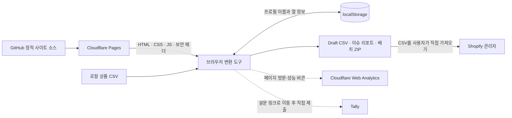
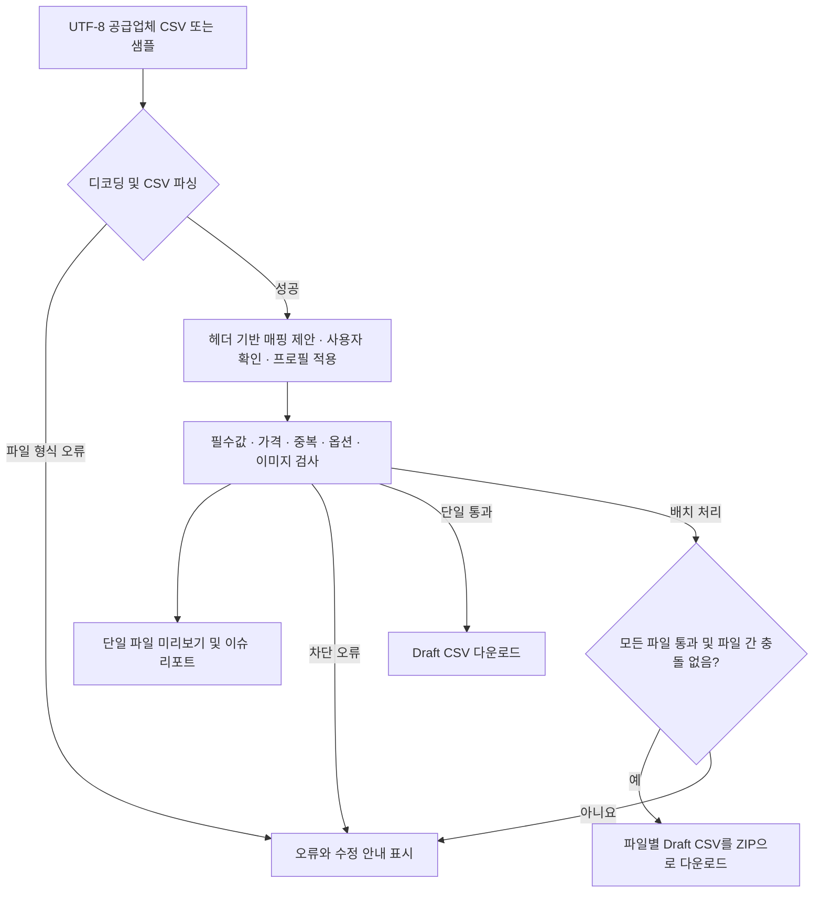

# ShopCSV Fixer

공급업체 상품 CSV를 검증하고 Shopify 신규 단순 상품용 Draft CSV로 변환하는 브라우저 도구입니다. **2026년 11월 개인 프로젝트**입니다.

[실제 서비스](https://shopcsv-fixer.pages.dev/) · [변환 도구](https://shopcsv-fixer.pages.dev/tool.html) · [포트폴리오 상세](docs/PORTFOLIO.md)


## 개발 배경

공급업체마다 상품명, SKU, 판매가의 열 이름과 순서가 다릅니다. 판매가가 빠졌거나 여러 상품이 같은 URL handle을 사용하는 경우 Shopify에 가져오기 전에 원본을 검토할 수 있어야 합니다. ShopCSV Fixer는 원본을 그대로 두고, 재사용할 수 있는 컬럼 매핑과 행별 오류 리포트를 제공한 뒤 검증을 통과한 데이터로 가져오기용 CSV를 생성합니다.

## 기술 스택과 디렉터리

운영 사이트는 HTML, CSS, Vanilla JavaScript로 구성합니다. 파일 입출력에는 File API, TextDecoder, TextEncoder, Blob을 사용하고 프로필은 localStorage에 저장합니다. GitHub에서 소스를 관리하고 Cloudflare Pages가 정적 파일을 제공합니다. 자동 테스트는 Node.js 내장 `node:test`와 `node:assert/strict`를 사용합니다.

```text
.
├── README.md
├── ShopCSV_Fixer_v0_5_Site_Deploy/   # Cloudflare Pages 정적 사이트
│   ├── index.html                   # 서비스 소개
│   ├── tool.html                    # 변환 화면
│   ├── feedback.html, privacy.html  # 설문 링크와 개인정보 고지
│   ├── _headers, robots.txt
│   └── assets/
│       ├── core.js                  # CSV 파싱, 검증, 변환
│       ├── repeat.js                # 매핑 프로필, 배치, ZIP
│       ├── app.js                    # 파일 입출력, UI
│       ├── site.css
│       └── config.js, feedback.js   # 이전 피드백 UI 자산
├── tests/
│   ├── run.cjs                      # 코어 테스트
│   ├── repeat_v04.cjs               # 프로필, 배치, ZIP 테스트
│   ├── security_v05.cjs             # CSV 출력과 보안 정책 테스트
│   └── samples/                     # 합성 CSV 및 배치 예제
└── docs/
    ├── PORTFOLIO.md
    └── screenshots/                 # 공개 서비스 화면
```

## 시스템 아키텍처



파일을 브라우저에서 처리해 별도 업로드 서버와 상품 데이터베이스가 필요 없습니다. Shopify 계정 연동 없이 운영할 수 있는 대신 스토어의 기존 상품이나 가져오기 설정을 조회할 수 없습니다. Cloudflare Pages 사이트의 배포 자산과 `_headers`는 `ShopCSV_Fixer_v0_5_Site_Deploy/`에 있고, 문서와 테스트는 그 밖에 둡니다.

## CSV 데이터 처리 흐름



## 주요 기능과 기술적 의사결정

- **CSV 파싱.** 외부 CSV 라이브러리 없이 `parseCSV()`가 문자를 순회하며 따옴표 안과 밖을 구분합니다. UTF-8 BOM, CRLF, 인용 필드 안의 줄바꿈과 이중 따옴표 이스케이프를 처리합니다. `delimiterFromText()`는 앞부분 6개 물리 줄에서 쉼표·세미콜론·탭의 등장 횟수로 구분자를 추정합니다. 닫히지 않은 따옴표, 빈 헤더, 정규화 후 중복 헤더, 행별 열 개수 불일치는 가져오기 전에 중단합니다.
- **자동 매핑과 판매가 검증.** `suggestMapping()`은 대소문자, 공백, 일부 구두점을 정규화한 헤더를 필드별 동의어와 비교합니다. 사용자가 제안을 교정할 수 있고, `Title`과 `Price`는 필수입니다. `Price`는 판매가이며 원가 출력 열은 없습니다. `Unit Price`처럼 의미가 모호한 헤더는 판매가 열인지 확인해야 합니다. 통화 기호, 음수, 천 단위 구분자, 소수점 셋째 자리부터는 오류이며 0은 경고합니다.
- **Handle과 SKU 충돌.** 명시적 Handle이 없으면 `slugify()`가 제목을 영문 소문자·숫자·하이픈 형식으로 변환합니다. `describeDuplicate()`는 반복 Handle을 완전 중복, 다른 상품명 간 충돌, 추가 이미지 후보, 변형 후보, 관계 불명으로 분류합니다. 상품 행을 자동으로 합치지 않고 반복 Handle, 반복 SKU, 값이 있는 옵션 후보 열을 차단합니다.
- **매핑 프로필.** `makeProfile()`은 프로필 이름, 원본 헤더, 필드별로 선택한 열 이름을 저장합니다. `applyProfile()`은 정규화한 헤더 집합이 동일할 때 현재 열 이름으로 인덱스를 다시 찾습니다. 같은 공급업체가 열 순서를 변경해도 재사용할 수 있으며, 열 자체가 추가되거나 빠졌다면 새 매핑이 필요합니다. 최대 40개를 같은 브라우저 오리진에 저장합니다.
- **배치와 ZIP.** `batchConvert()`는 기준 CSV와 같은 헤더 집합을 가진 입력 최대 10개를 변환합니다. 파일별 검증을 통과한 행의 Handle과 SKU를 파일 사이에서도 비교하고, 오류가 하나라도 있으면 전체 ZIP 출력을 차단합니다. `makeZip()`은 UTF-8 바이트와 파일별 CRC32를 계산하고, `Uint8Array`와 `DataView`로 로컬 헤더, 중앙 디렉터리, 종료 레코드를 기록합니다. 파일별 CSV가 들어 있는 무압축 ZIP을 브라우저에서 내려받습니다.
- **Shopify Draft 출력.** `convert()`는 11개 열을 고정 순서로 만들고, 기본 옵션을 `Title` / `Default Title`로 지정합니다. 모든 행에 `Status=draft`, `Published on online store=false`를 기록합니다. 사용자는 생성한 CSV를 검토한 후 Shopify 관리자에서 가져옵니다. [Shopify 상품 CSV 형식](https://help.shopify.com/en/manual/products/import-export/using-csv)

## 트러블슈팅: 이미지 등록과 Safe Mode

v0.2 개발 스토어 검증 기록에는 단순 상품 2개가 초안으로 생성됐지만, 예시 이미지 URL을 사용한 상품 하나의 미디어 등록이 실패했다고 남아 있습니다. 상품 필드와 이미지 등록을 분리하기 위해 v0.3부터 기본 Safe Mode에서 `Product image URL`을 비우고 제외한 행에 경고를 표시했습니다. 개발 기록에는 이 모드로 내보낸 v0.3 CSV의 상품 2개를 추가로 초안 등록한 내용도 남아 있습니다.

이미지 포함 모드에서는 `inspectImageURL()`이 공개 HTTPS URL 형식을 확인하고 예시 도메인, 일부 로컬·사설 호스트, 인증 정보가 들어간 URL을 차단합니다. 형식이 통과한 링크의 응답, 콘텐츠 유형, 실제 Shopify 다운로드 성공 여부는 검사하지 않습니다.

## 보안과 개인정보 보호

- 공급업체 CSV의 읽기·파싱·변환·다운로드는 브라우저 안에서 처리합니다. 프로필에는 이름과 헤더 매핑을 남기며 상품 행은 저장하지 않습니다. 헤더 이름 자체에 내부 정보가 들어갈 수 있습니다.
- CSV Injection 방어를 위해 내보내는 상품명, 공급업체, 설명, SKU의 수식형 접두사를 검사합니다. 위험한 입력은 차단하고 이슈 리포트의 수식형 셀은 대체 문자열로 바꿉니다. UI는 원본 값을 HTML로 렌더링할 때 이스케이프하고, 매핑한 텍스트 필드의 HTML 형태 입력을 차단합니다.
- Cloudflare Pages의 `_headers`는 CSP 기본 차단을 적용합니다. 스크립트는 자체 자산과 `static.cloudflareinsights.com`을 허용하고, `connect-src`는 `https://cloudflareinsights.com`만 허용합니다. 폼 전송, 페이지 프레이밍, 객체 임베딩도 제한합니다. Cloudflare의 운영 비콘은 페이지 방문·성능에 사용되며 피드백 페이지는 별도 Tally 설문으로 이동합니다. [개인정보 안내](https://shopcsv-fixer.pages.dev/privacy.html) · [Cloudflare Web Analytics CSP](https://developers.cloudflare.com/web-analytics/faq/)

## 로컬 실행

프로젝트의 `ShopCSV_Fixer_v0_5_Site_Deploy/index.html`을 브라우저에서 열고 **Open free tool**을 선택합니다. 프로필 저장처럼 오리진이 필요한 동작을 확인하려면 Python 3으로 정적 사이트 디렉터리만 제공합니다.

```sh
python3 -m http.server 8000 --bind 127.0.0.1 --directory ShopCSV_Fixer_v0_5_Site_Deploy
```

브라우저에서 `http://127.0.0.1:8000/tool.html`을 엽니다. 내장 샘플이나 `tests/samples/`의 CSV를 파일 선택으로 불러올 수 있습니다. 로컬 정적 서버 실행은 Cloudflare Pages 응답 헤더를 재현하지 않습니다.

## 테스트 실행과 결과

저장소 루트에서 실행합니다. Node.js v22.23.3으로 확인했으며 패키지 설치는 필요 없습니다.

```sh
node --test tests/*.cjs
```

| 테스트 | 검증 항목 | 결과 |
| --- | --- | --- |
| `run.cjs` | CSV 파싱·직렬화, 필수값·가격, 중복·변형, 이미지 정책, Draft·비공개 출력 | 45/45 |
| `repeat_v04.cjs` | 헤더 순서 변경, 프로필 호환성, 파일 간 충돌, 배치 제한, ZIP 구조와 파일명 | 12/12 |
| `security_v05.cjs` | 수식형 셀·HTML 입력, 리포트 셀 보호, 파서 크기 제한, 정적 HTML 및 CSP | 11/11 |
| **합계** | | **68개 실행 · 68개 통과 · 0개 실패** |

이전 CSP 테스트는 `connect-src 'none'`을 기대했습니다. 현재 테스트는 파싱한 CSP 지시문과 정확한 허용 목록을 비교해 다른 연결 호스트나 와일드카드가 추가되는 경우 실패합니다.

### 공개 서비스 브라우저 검증

Chrome 158에서 데스크톱(1440 × 1100)과 모바일 에뮬레이션(390 × 844)으로 랜딩과 도구 화면을 확인했습니다. 두 화면 크기에서 합성 CSV를 검증하고, 데스크톱에서 다음 동작을 확인했습니다.

- 헤더 기반 자동 매핑과 수동 매핑, 필수 판매가 매핑 누락 시 내보내기 차단
- 중복 Handle, 중복 SKU, 잘못된 판매가의 오류 표시 및 내보내기 차단
- Safe Mode 이미지 제외, Draft CSV 다운로드 및 모든 행의 초안·비공개 값 확인
- 페이지를 다시 연 후 저장한 프로필을 열 순서가 다른 CSV에 복원
- 파일 2개의 일괄 검증과 ZIP 다운로드, ZIP 내부 CSV 2개 및 CRC 확인, 파일 간 Handle 충돌 시 ZIP 차단

테스트 구간에서 브라우저 콘솔 오류와 경고는 관찰되지 않았습니다. 현재 버전의 Shopify Import, 모바일 실기기, Safari 검증은 남아 있습니다. 위 개발 스토어 사례는 이전 버전의 기록입니다.

[컬럼 매핑](docs/screenshots/02-file-and-column-mapping.png) · [Handle 오류 차단](docs/screenshots/04-handle-error-blocked.png) · [프로필 및 배치](docs/screenshots/07-batch-zip-ready.png) · [모바일 랜딩](docs/screenshots/08-landing-mobile.png)

## 지원 범위와 한계

- 신규 단순 상품용입니다. 변형, 여러 이미지 행, 재고 동기화, 기존 상품 업데이트는 지원 범위 밖입니다. Shopify 관리자에서 소수 상품으로 가져오기 설정과 결과를 먼저 확인할 수 있습니다.
- UTF-8 파일당 최대 5,000행과 80열이 기준입니다. 단일 파일 선택은 최대 5 MiB, 배치 선택은 10개·총 20 MiB까지 검사합니다. 파서와 배치 코어는 디코딩한 문자열 길이도 검사합니다.
- 구분자 자동 추정은 따옴표 안의 구분자 개수에도 영향을 받으며 UI에서 강제 지정할 수 없습니다. 비라틴 문자만 있는 제목은 명시적 영문 Handle이 필요할 수 있습니다.
- 파일 전체를 메모리에 읽고 메인 스레드에서 처리합니다. 큰 파일과 ZIP의 처리 시간은 브라우저와 기기에 따라 달라집니다.
