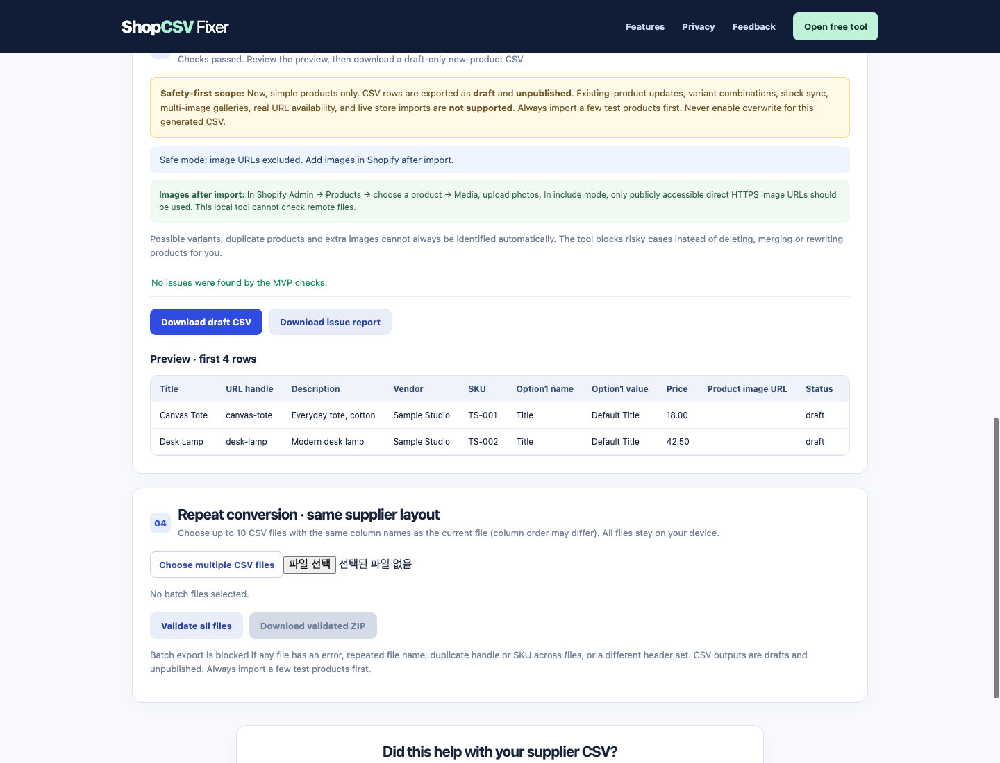
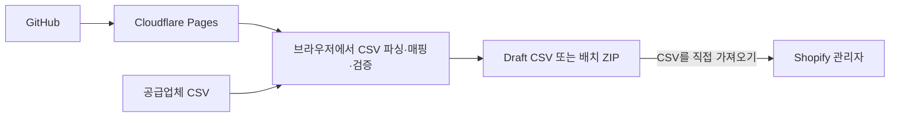

# ShopCSV Fixer

공급업체 상품 CSV에서 판매가나 중복 상품을 확인하고, Shopify에서 가져올 수 있는 신규 상품용 Draft CSV를 만드는 브라우저 도구입니다. 2026년 11월에 만든 개인 프로젝트입니다.

[서비스 열기](https://shopcsv-fixer.pages.dev/) · [변환 도구](https://shopcsv-fixer.pages.dev/tool.html) · [구현과 검증 기록](docs/PORTFOLIO.md)

## 만든 이유

공급업체마다 상품명, SKU, 판매가를 적는 열 이름과 순서가 다릅니다. 파일을 받을 때마다 열을 다시 맞추고, 판매가가 비었거나 같은 Handle이 반복된 행을 찾아야 합니다. 이 작업을 Shopify에 가져오기 전에 할 수 있도록 만들었습니다.

## 할 수 있는 일

- UTF-8 CSV의 쉼표·세미콜론·탭 구분자를 추정하고, 헤더 이름을 보고 매핑을 제안합니다. 제안한 열은 화면에서 바꿀 수 있습니다.
- 판매가 누락이나 형식 오류, 중복 Handle·SKU를 행별로 보여줍니다. 차단 오류가 있으면 상품 CSV 대신 문제를 담은 리포트를 받을 수 있습니다.
- 검증을 통과하면 초안·온라인 스토어 비공개 값이 들어간 CSV를 내려받습니다. 기본 Safe Mode에서는 이미지 URL을 비웁니다.
- 같은 열 집합을 쓰는 파일에는 저장한 매핑을 다시 적용할 수 있습니다. 최대 10개 파일을 함께 검사하고, 모두 통과하면 ZIP으로 받습니다.



## 기술 스택과 구조

HTML, CSS, Vanilla JavaScript로 만든 정적 사이트를 Cloudflare Pages에 배포했습니다. 상품 CSV는 브라우저에서 읽고 변환하며, 매핑 프로필은 `localStorage`에 저장합니다.



배포 파일은 [ShopCSV_Fixer_v0_5_Site_Deploy/](ShopCSV_Fixer_v0_5_Site_Deploy/)에 있습니다. `assets/core.js`가 파싱과 검증을, `repeat.js`가 프로필과 배치 처리를, `app.js`가 화면과 파일 입출력을 맡습니다. [개인정보 안내](https://shopcsv-fixer.pages.dev/privacy.html)

## 로컬에서 실행하기

저장소 루트에서 Python 3으로 정적 파일을 제공합니다.

```sh
python3 -m http.server 8000 --bind 127.0.0.1 --directory ShopCSV_Fixer_v0_5_Site_Deploy
```

브라우저에서 `http://127.0.0.1:8000/tool.html`을 열고 **Try clean sample → Validate & preview**를 누릅니다. [합성 CSV](tests/samples/)를 직접 선택해도 됩니다.

## 테스트

Node.js v22.23.3에서 패키지 설치 없이 실행했습니다.

```sh
node --test tests/*.cjs
```

기존 실행 결과는 **68개 통과, 0개 실패**입니다. 코어 45개, 프로필·배치·ZIP 12개, 보안 11개입니다. 공개 서비스의 Chrome 데스크톱·모바일 에뮬레이션 결과는 [포트폴리오 검증 기록](docs/PORTFOLIO.md#테스트와-서비스-확인)에 정리했습니다.

## 지원 범위

신규 단순 상품을 대상으로 합니다. 상품 변형, 여러 이미지 행, 재고 동기화, 기존 상품 업데이트는 지원 범위 밖입니다. 단일 파일 선택은 최대 5 MiB, 5,000행, 80열이며 배치는 최대 10개·총 20 MiB입니다. CSV는 Shopify 관리자에서 직접 가져오며, 현재 배포 버전의 Shopify Import는 아직 검증하지 않았습니다.
