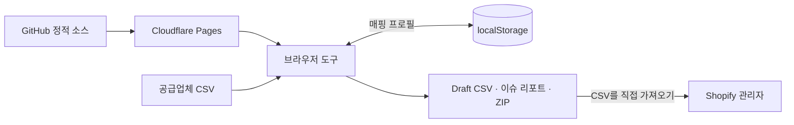

# ShopCSV Fixer 포트폴리오

**2026년 11월 · 개인 프로젝트**

[실제 서비스](https://shopcsv-fixer.pages.dev/) · [변환 도구](https://shopcsv-fixer.pages.dev/tool.html) · [기술 README](../README.md)

## 프로젝트 카드

공급업체 CSV의 판매가, 중복 Handle, SKU 오류를 브라우저에서 검증하고 Shopify 신규 상품용 Draft CSV로 변환합니다. 저장한 컬럼 매핑을 재사용해 최대 10개 파일을 일괄 검증하고 ZIP으로 내려받을 수 있습니다.

## 상세 소개

공급업체마다 열 이름과 순서가 달라 Shopify에 가져오기 전 매핑과 검토를 반복해야 합니다. ShopCSV Fixer는 헤더 동의어로 매핑을 제안하고, 자동으로 해석하기 어려운 상품 관계와 잘못된 가격을 오류로 표시합니다. 사용자는 수정 안내와 이슈 리포트를 보고 원본을 검토한 뒤 검증을 다시 실행할 수 있습니다. 변환 결과는 Draft 및 온라인 스토어 비공개 값을 포함하며 Shopify 관리자에서 직접 가져옵니다.

**기술 스택**

HTML · CSS · Vanilla JavaScript · File API · TextDecoder · Blob · localStorage · Node.js 테스트 · Cloudflare Pages

## 아키텍처

정적 사이트는 화면과 검증 코드를 전달합니다. 상품 파일은 브라우저 메모리에서 읽고, 반복 작업을 위해 프로필 이름과 열 정보만 로컬 저장소에 남깁니다. Cloudflare Web Analytics와 Tally는 각각 페이지 분석과 선택적 설문에 사용합니다.

## 핵심 구현 사례

1. **CSV 파싱과 매핑 제안.** 따옴표 안·밖 상태를 추적해 줄바꿈과 구분자가 포함된 필드를 파싱합니다. 헤더를 정규화하고 동의어와 비교해 매핑을 제안하며, 금액 형식과 판매가 열 자체의 의미는 별개로 검토할 수 있게 했습니다.
2. **중복 Handle 분류.** 제목·SKU·이미지 URL과 원본 행을 비교해 완전 중복, Handle 충돌, 이미지 추가 후보, 변형 후보 등을 표시합니다. 판단이 필요한 행은 차단하고 수정 안내를 제공합니다.
3. **열 순서 변경과 배치 검증.** 저장 프로필은 원본 열 이름을 보관합니다. 정규화한 열 집합이 같을 때만 현재 인덱스로 다시 매핑해, 열 순서 변경을 허용하면서 다른 스키마의 자동 적용을 막습니다. 배치에서는 파일 간 Handle과 SKU도 검사합니다.
4. **브라우저 ZIP 내보내기.** 검증을 모두 통과한 파일을 개별 Draft CSV로 직렬화한 후 무압축 ZIP으로 묶습니다. 각 엔트리의 CRC32와 바이트 오프셋을 기록하는 데 `Uint8Array`와 `DataView`를 사용합니다.

## 트러블슈팅

이전 Shopify 개발 스토어 검증에서 초안 상품은 생성됐지만, 예시 이미지 링크를 참조한 상품의 미디어 등록이 실패했습니다. Safe Mode를 기본으로 적용해 이미지 링크를 비우고 경고를 표시하도록 바꿨습니다. 이미지가 필요한 경우에는 HTTPS 및 호스트 형식을 검증한 뒤 미확인 링크로 표시합니다. 개발 기록에는 v0.3 Safe Mode CSV로 단순 상품 2개를 초안 등록한 결과가 남아 있습니다.

## 실제 테스트 결과와 제한

현재 배포 소스에 연결한 Node.js 테스트 **68개를 실행해 68개 통과, 0개 실패**했습니다. 코어 45개, 프로필·배치·ZIP 12개, 보안 11개입니다. 보안 테스트는 수식형 입력과 HTML 입력, 이슈 리포트 셀, CSP의 분석 호스트 허용 범위를 검사합니다.

공개 서비스에서는 Chrome 158 데스크톱과 모바일 에뮬레이션으로 화면과 정상 CSV 검증을 확인했습니다. 데스크톱에서는 실제 Draft CSV와 배치 ZIP을 내려받아 초안·비공개 값과 이미지 제외를 확인했습니다. 저장한 프로필을 열 순서가 다른 파일에 복원했고, 중복 Handle·SKU, 잘못된 판매가와 파일 간 Handle 충돌이 결과 내보내기를 차단하는 것도 확인했습니다. 테스트 구간에서 콘솔 오류와 경고는 관찰되지 않았습니다.

현재 버전의 Shopify Import, 모바일 실기기, Safari 검증은 남아 있습니다. 개발 스토어의 초안 등록 사례는 이전 버전의 기록입니다.

지원 범위는 신규 단순 상품입니다. 변형, 다중 이미지, 재고 동기화, 기존 상품 업데이트는 지원 범위 밖입니다. 이미지 URL의 실제 응답은 검사하지 않으며, 큰 입력은 메인 스레드 처리와 메모리 사용량의 영향을 받습니다.

## 면접에서 설명할 코드

| 코드 | 설명할 내용 |
| --- | --- |
| [`parseCSV()`, `delimiterFromText()`, `suggestMapping()`](../ShopCSV_Fixer_v0_5_Site_Deploy/assets/core.js) | 인용 필드 상태 전이, 구분자 추정 방식과 오판 가능성, 헤더 동의어 |
| [`convert()`, `describeDuplicate()`, `inspectImageURL()`, `safeReportCSV()`](../ShopCSV_Fixer_v0_5_Site_Deploy/assets/core.js) | 차단 오류와 경고 구분, 모호한 상품 관계, Safe Mode, CSV Injection 방어 |
| [`makeProfile()`, `applyProfile()`, `batchConvert()`](../ShopCSV_Fixer_v0_5_Site_Deploy/assets/repeat.js) | 인덱스 대신 열 이름을 저장한 이유, 파일 간 충돌 검사 |
| [`makeZip()`, `crc32()`](../ShopCSV_Fixer_v0_5_Site_Deploy/assets/repeat.js) | ZIP 레코드와 파일별 바이트 오프셋, 브라우저 안에서의 무압축 내보내기 |
| [`readUTF8()`, `validate()`, `downloadBlob()`](../ShopCSV_Fixer_v0_5_Site_Deploy/assets/app.js) | 파일 디코딩과 파서 분리, 브라우저 UI에서 오류와 다운로드를 연결하는 방법 |
| [`_headers`](../ShopCSV_Fixer_v0_5_Site_Deploy/_headers) | Cloudflare Pages 응답 헤더와 분석에 필요한 CSP 허용 범위 |

## 실제 서비스 스크린샷

| 화면 | 확인할 내용 |
| --- | --- |
| [랜딩 · 모바일](screenshots/08-landing-mobile.png) | Chrome 모바일 에뮬레이션의 서비스 진입 화면 |
| [파일 선택과 컬럼 매핑](screenshots/02-file-and-column-mapping.png) | 합성 CSV의 헤더와 자동 선택된 판매가 열 |
| [정상 검증과 미리보기](screenshots/03-valid-preview.png) | Safe Mode, Draft CSV 다운로드, 상품 미리보기 |
| [중복 Handle 오류](screenshots/04-handle-error-blocked.png) | 원인과 수정 안내, 비활성화된 Draft CSV 다운로드 |
| [저장 프로필과 배치](screenshots/07-batch-zip-ready.png) | 복원한 프로필과 CSV 2개의 검증 결과, ZIP 다운로드 버튼 |

개발 스토어 화면은 현 버전 가져오기를 확인한 뒤 추가할 수 있습니다.
