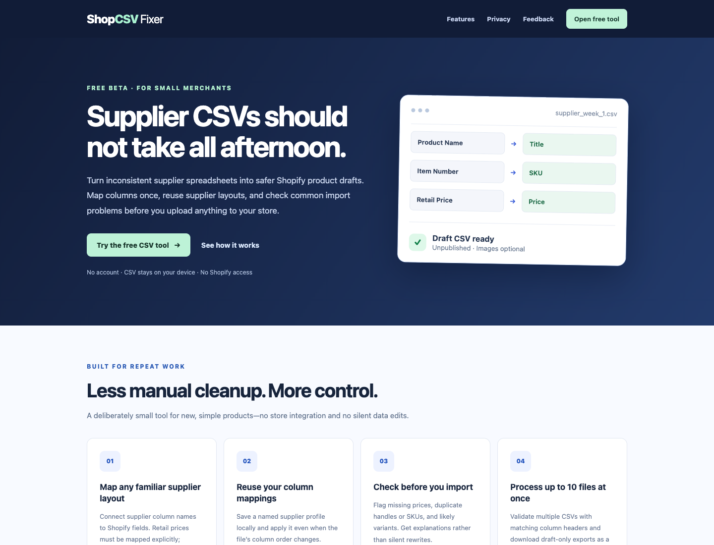

# ShopCSV Fixer

공급업체 상품 CSV를 검토하고 Shopify에 가져올 신규 상품용 초안 파일을 만드는 웹 도구입니다.

**2026년 11월 · 개인 프로젝트**

CSV 변환과 검증, 매핑·배치 화면 구현, 테스트 정리와 정적 사이트 배포를 맡았습니다.

[실제 서비스](https://shopcsv-fixer.pages.dev/) · [변환 도구](https://shopcsv-fixer.pages.dev/tool.html) · [실행 방법](../README.md)

## 개발 배경

같은 상품 목록도 공급업체마다 상품명, SKU, 판매가를 적는 열 이름이 다릅니다. 특히 `Unit Price`는 파일을 준 곳에 따라 판매가인지 원가인지 숫자만 보고 알기 어렵습니다. 매핑을 화면에서 먼저 확인하고, 판매가 오류나 중복 상품이 있는 행은 Shopify에 파일을 넣기 전에 검토할 수 있도록 했습니다.

사용자는 CSV를 열고 컬럼을 맞춘 뒤 검증 결과를 봅니다. 오류가 있으면 행 번호와 수정 안내를 보고, 통과하면 Draft CSV를 받습니다. 같은 공급업체 파일을 반복해서 다룰 때는 매핑을 저장해 두고 여러 파일을 한 번에 검사할 수 있습니다.

## 브라우저에서 파일을 처리한 이유

상품 CSV를 받는 서버를 따로 두면 파일 전송과 보관도 관리해야 합니다. 이 도구에서는 브라우저가 파일을 읽고 결과를 내려받는 데까지 처리합니다. HTML·CSS·JavaScript만 Cloudflare Pages에서 제공하고, Shopify 가져오기는 사용자가 관리자 화면에서 직접 진행합니다. 매핑을 저장할 때도 상품 행 없이 프로필 이름과 헤더·매핑 정보만 같은 브라우저에 남깁니다.

CSV 처리와 별도로, 공개 사이트의 페이지 방문·성능 분석에는 Cloudflare Web Analytics를 사용합니다. 정적 응답의 CSP는 기본 차단을 적용하고, 자체 스크립트와 비콘 호스트 `static.cloudflareinsights.com`을 허용합니다. 외부 연결은 `cloudflareinsights.com`으로 제한합니다. 피드백은 별도 Tally 설문 링크로 받습니다.

## 구현 과정

### 파일을 읽고 열을 맞추기

`readUTF8()`에서 잘못된 UTF-8을 걸러낸 뒤 외부 CSV 라이브러리 없이 만든 `parseCSV()`로 넘깁니다. 파서는 따옴표 안과 밖을 구분해서 상품명에 쉼표가 있거나 설명이 여러 줄인 경우에도 한 셀로 읽습니다. UTF-8 BOM, CRLF, 이중 따옴표를 처리하고 닫히지 않은 따옴표, 빈 헤더나 중복 헤더, 행마다 다른 열 개수는 파일 오류로 표시합니다. 구분자는 파일 앞 6줄에서 쉼표·세미콜론·탭이 나온 횟수로 추정합니다.

`suggestMapping()`은 헤더의 대소문자·공백·일부 구두점을 정리하고, `Product Name`이나 `Retail Price` 같은 동의어를 찾아 매핑을 제안합니다. `Title`과 판매가인 `Price`는 필수이고 원가 열은 출력하지 않습니다. 통화 기호나 천 단위 구분자가 들어간 값, 음수, 소수점 아래 세 자리 이상인 값은 오류로 표시하고, 0은 확인할 수 있도록 경고를 남깁니다.

### 중복을 표시하고 가져오기 파일 만들기

같은 Handle이 반복되어도 원인은 여러 가지입니다. 원본 행이 같은 경우와 제목만 같은 경우, SKU나 이미지 URL이 다른 경우를 `describeDuplicate()`에서 비교합니다. 완전 중복, Handle 충돌, 변형·추가 이미지 후보 등으로 표시한 뒤 사용자가 원본을 검토할 때까지 내보내기를 막습니다. Handle이 비어 있으면 제목에서 영문 소문자·숫자·하이픈으로 만들고, SKU 중복이나 값이 채워진 옵션 후보 열도 확인합니다.

`convert()`는 Shopify 상품용 11개 열을 만들고 모든 행에 `Status=draft`와 `Published on online store=false`를 넣습니다. 기본 옵션은 `Title` / `Default Title`입니다. 상품명·설명 등에서 스프레드시트 수식으로 해석될 수 있는 접두사나 HTML 형태 입력을 차단하고, 이슈 리포트의 수식형 셀에는 대체 문자열을 넣습니다. 화면에 원본 값을 표시할 때는 HTML 이스케이프를 적용합니다.

### 저장한 매핑으로 여러 파일 처리하기

매핑을 열 번호로 저장하면 같은 공급업체가 열의 순서만 바꿔도 다른 값을 읽게 됩니다. `makeProfile()`은 열 이름을 저장하고, `applyProfile()`은 정규화한 헤더 집합이 같을 때 현재 파일에서 열 번호를 다시 찾습니다. 프로필은 최대 40개까지 저장합니다.

`batchConvert()`는 같은 열 집합을 가진 파일을 최대 10개 처리합니다. 개별 파일을 검증한 뒤 파일 간 Handle과 SKU 중복도 확인합니다. 모두 통과하면 `makeZip()`이 개별 CSV를 무압축 ZIP에 담습니다. 각 파일의 CRC32를 구하고, `Uint8Array`와 `DataView`로 로컬 헤더와 중앙 디렉터리, 종료 레코드를 기록합니다.

## 이미지 링크가 있어도 미디어 등록이 실패한 경우

v0.2 개발 스토어 검증에서는 단순 상품 2개가 초안으로 생성됐지만, 예시 이미지 URL을 사용한 상품 한 개의 미디어 등록이 실패했습니다. v0.3부터 기본 Safe Mode에서 이미지 열을 비우고, 어떤 행에서 링크를 제외했는지 경고로 표시하도록 바꿨습니다. 이후 개발 기록에는 Safe Mode CSV로 단순 상품 2개를 추가 등록한 결과가 남아 있습니다.

이미지를 포함할 때는 `inspectImageURL()`이 HTTPS 형식을 확인하고 예시 도메인, 일부 로컬·사설 호스트, 인증 정보가 담긴 URL을 차단합니다. 형식을 통과해도 링크의 실제 응답이나 Shopify에서의 다운로드 성공 여부는 확인할 수 없어서 화면에 미검증으로 표시합니다.

## 테스트와 서비스 확인

Node.js 테스트는 **68개 통과, 0개 실패**였습니다. 코어 45개, 프로필·배치·ZIP 12개, 보안 11개입니다. 보안 테스트에는 수식형 셀, HTML 입력, 리포트 내보내기, 현재 CSP의 허용 목록 검사가 포함됩니다.

공개 서비스는 Chrome 158에서 확인했습니다. 데스크톱(1440 × 1100)과 모바일 에뮬레이션(390 × 844)으로 랜딩·도구를 열고 정상 CSV를 검증했습니다. 데스크톱에서는 아래 동작도 확인했습니다.

- 자동 매핑을 바꿔 다시 검증하고, 필수 판매가 매핑 누락·중복 Handle·중복 SKU·잘못된 판매가가 내보내기를 막는지 확인했습니다.
- 내려받은 Draft CSV에서 모든 행의 초안·비공개 값과 빈 이미지 열을 확인했습니다.
- 새로고침 후 저장한 프로필을 열 순서가 다른 CSV에 복원했습니다. 배치 ZIP을 내려받아 CSV 2개와 CRC를 확인했고, 파일 간 Handle 충돌이 있으면 ZIP 다운로드가 차단됐습니다.

테스트 중 콘솔 오류·경고는 관찰되지 않았습니다. 현재 버전의 Shopify Import, 모바일 실기기, Safari는 아직 검증하지 않았습니다.

## 한계

신규 단순 상품에 맞춘 도구라 변형, 여러 이미지 행, 재고 동기화, 기존 상품 업데이트를 지원하지 않습니다. 스토어의 기존 Handle도 조회하지 않습니다. 구분자 추정은 따옴표 안의 구분자에 영향을 받을 수 있습니다. 화면에서 구분자를 직접 선택하는 기능은 없습니다. 비라틴 문자만 있는 제목은 영문 Handle을 직접 지정해야 할 수 있습니다. 파일 전체를 메모리에 읽고 메인 스레드에서 처리하므로 큰 입력은 기기 성능의 영향을 받습니다.

## 실제 서비스 화면

[모바일 랜딩](screenshots/08-landing-mobile.png) · [컬럼 매핑](screenshots/02-file-and-column-mapping.png) · [정상 검증](screenshots/03-valid-preview.png) · [Handle 오류](screenshots/04-handle-error-blocked.png) · [프로필과 배치](screenshots/07-batch-zip-ready.png)
